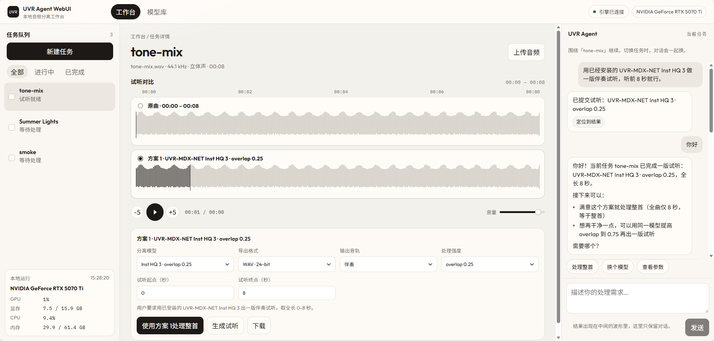

<p align="center">
  <picture>
    <source media="(prefers-color-scheme: dark)" srcset="https://readme-typing-svg.demolab.com?font=Fira+Code&weight=700&size=28&duration=3000&pause=1000&color=A78BFA&center=true&vCenter=true&width=500&lines=%F0%9F%8E%B5+UVR+Headless+Runner;%E9%9F%B3%E9%A2%91%E5%88%86%E7%A6%BB%E5%91%BD%E4%BB%A4%E8%A1%8C%E5%B7%A5%E5%85%B7">
    
  </picture>
</p>

<h3 align="center">🎧 从任意音频中分离人声、乐器、鼓、贝斯等</h3>

<p align="center">
  <strong>基于 UVR 的命令行音频分离工具</strong>
</p>

<p align="center">
  <a href="https://github.com/chyinan/uvr-headless-runner/blob/master/LICENSE">
    
  </a>
  <a href="https://www.python.org/downloads/">
    
  </a>
  <a href="https://pytorch.org/">
    
  </a>
  <a href="https://github.com/chyinan/uvr-headless-runner">
    
  </a>
  <a href="https://pypi.org/project/uvr-headless-runner/">
    
  </a>
</p>

<p align="center">
  <strong>🇨🇳 中文</strong> | <a href="README.md">🇬🇧 English</a> | <a href="DOCKER_README_CN.md">🐳 Docker</a>
</p>

<p align="center">
  <a href="AGENT_WEBUI.md"><strong>🌐 网页工作台（WebUI）</strong></a> — 基于浏览器的音频分离界面，支持任务队列、试听与 Agent 助手
</p>

<p align="center">
  
</p>

---

## ✨ 功能特性

<table>
<tr>
<td width="33%">

### 🎸 MDX-Net 运行器
- MDX-Net / MDX-C 模型
- **Roformer** (MelBandRoformer, BSRoformer)
- **SCNet** (稀疏压缩网络)
- 支持 ONNX & PyTorch 格式

</td>
<td width="33%">

### 🥁 Demucs 运行器
- Demucs v1 / v2 / v3 / v4
- **htdemucs** / **htdemucs_ft**
- **6轨分离** (吉他、钢琴)
- 模型自动下载

</td>
<td width="33%">

### 🎤 VR 运行器
- VR Architecture 模型
- **VR 5.1** 模型支持
- 窗口大小 / 激进度调节
- TTA 和后处理

</td>
</tr>
</table>

### 🚀 亮点

<table>
<tr>
<th width="50%">特性</th>
<th width="50%">说明</th>
</tr>
<tr><td>🎯 <b>GUI 行为一致</b></td><td>完全复制 UVR GUI 的行为逻辑</td></tr>
<tr><td>⚡ <b>GPU 加速</b></td><td>支持 NVIDIA CUDA 和 AMD DirectML</td></tr>
<tr><td>🔧 <b>零配置</b></td><td>自动检测模型参数</td></tr>
<tr><td>📦 <b>批量处理</b></td><td>适合自动化和流水线</td></tr>
<tr><td>🎚️ <b>位深控制</b></td><td>16/24/32-bit PCM，32/64-bit 浮点</td></tr>
<tr><td>📥 <b>自动下载</b></td><td>官方 UVR 模型注册表 + 自动下载</td></tr>
<tr><td>🛡️ <b>健壮错误处理</b></td><td>GPU 回退、重试、模糊匹配</td></tr>
<tr><td>🔗 <b>统一 CLI</b></td><td><code>uvr mdx</code> / <code>uvr demucs</code> / <code>uvr vr</code> — 一条命令搞定</td></tr>
<tr><td>📦 <b>PyPI 发布</b></td><td><code>pip install uvr-headless-runner</code> — 即装即用</td></tr>
</table>

---

## 🌐 WebUI（agent-webui 分支）

本分支在现有 CLI 运行器之上增加了本地的**网页工作台与单 Agent** 层。网页与 Agent 共用同一套任务服务；音频分离仍由原有 Runner 完成。

**主要能力**

- **浏览器工作台** — 上传音频、管理任务并在 `http://127.0.0.1:8787` 监控分离进度。
- **试听优先流程** — 先生成短片段试听（通常为前 30 秒），满意后再处理整首；也可直接开始整首处理。
- **批量处理** — 勾选已上传任务，将当前方案应用到多个文件；每首歌独立任务与产物，推理串行执行。
- **模型库与下载** — 浏览官方模型、筛选已安装/未安装模型，并在不占用推理槽的情况下触发下载。
- **硬件状态面板** — 在页面中实时查看 GPU/显存/CPU/内存等状态（可用时）。
- **Agent 助手** — 通过 OpenAI 兼容接口进行对话控制（可选）；未配置 API Key 时手动操作仍可用。
- **可调预设** — 音质相关预设与参数（如 MDX overlap、VR aggression、Demucs shifts）定义在 `agent_web/presets.json`。

**安装与使用**

环境搭建（控制服务独立 Python 环境、推理环境、前端构建）、配置、启动与当前验收记录请参见 **[AGENT_WEBUI.md](AGENT_WEBUI.md)**。

> **说明：** Demucs 没有单独的伴奏轨，制作伴奏请使用 MDX Inst 类模型。试听与整首使用同一套参数，但短片段与全曲上下文不同，听感不保证完全一致。服务重启后，运行中的任务会标记为中断，排队任务会暂停，需要手动继续。

---

## 📖 设计理念

> 
> 
> **本项目是 [Ultimate Vocal Remover](https://github.com/Anjok07/ultimatevocalremovergui) 的无头自动化层。**
> 
> 它**不会**重新实现任何分离逻辑。  
> 它**完全复制** UVR GUI 的行为 —— 包括模型加载、参数回退和自动检测。
> 
> **✅ 如果模型在 UVR GUI 中能用，这里就能用 —— 无需额外配置。**

---

## 🤔 为什么选择这个工具？

> 大多数命令行分离工具将你限制在预定义的模型列表中。作为高级用户，你需要更多。

<table>
<tr>
<td width="33%" align="center">

### 🎨 完全自定义模型

直接使用你的 `.pth` 或 `.ckpt` 文件。  
**没有硬编码列表，没有限制。**

</td>
<td width="33%" align="center">

### 🖥️ 无头 & 远程就绪

专为 Web 服务和自动化脚本  
**无缝集成**而设计。

</td>
<td width="33%" align="center">

### 👥 用户至上

由音频爱好者设计，  
**灵活性优先于限制。**

</td>
</tr>
</table>

---

## 📋 系统要求

| 组件 | 要求 |
|------|------|
| **Python** | 3.9.x（3.10+ 未完全测试） |
| **GPU** | NVIDIA CUDA 或 AMD DirectML *（可选）* |
| **系统** | Windows / Linux / macOS |

---

## 🔧 安装

<details open>
<summary><b>🚀 方式一：pip install 从 PyPI 安装（推荐）</b></summary>

```bash
# 从 PyPI 安装
pip install uvr-headless-runner

# GPU 支持 (NVIDIA)
pip install torch torchvision torchaudio --index-url https://download.pytorch.org/whl/cu124

# ONNX GPU（可选）
pip install onnxruntime-gpu
```

安装后即可使用 **`uvr` 统一命令** — 无需克隆仓库！

```bash
uvr mdx -m "UVR-MDX-NET Inst HQ 3" -i song.wav -o output/
uvr demucs -m htdemucs -i song.wav -o output/
uvr vr -m "UVR-De-Echo-Normal" -i song.wav -o output/
```

</details>

<details>
<summary><b>📦 方式二：Poetry（从源码安装）</b></summary>

```bash
# 克隆仓库
git clone https://github.com/chyinan/uvr-headless-runner.git
cd uvr-headless-runner

# 安装依赖
poetry install

# GPU 支持 (NVIDIA)
pip install torch torchvision torchaudio --index-url https://download.pytorch.org/whl/cu124

# ONNX GPU（可选）
pip install onnxruntime-gpu
```

</details>

<details>
<summary><b>📦 方式三：pip + venv（从源码安装）</b></summary>

```bash
# 克隆仓库
git clone https://github.com/chyinan/uvr-headless-runner.git
cd uvr-headless-runner

# 创建虚拟环境
python -m venv venv
source venv/bin/activate  # Linux/macOS
# venv\Scripts\activate   # Windows

# 安装依赖
pip install -r requirements.txt

# GPU 支持 (NVIDIA)
pip install torch torchvision torchaudio --index-url https://download.pytorch.org/whl/cu124
```

</details>

<details>
<summary><b>🔴 AMD 显卡（DirectML）</b></summary>

```bash
# 安装 DirectML 支持
pip install torch-directml

# 使用 --directml 参数
python mdx_headless_runner.py -m model.ckpt -i song.wav -o output/ --directml
```

> ⚠️ DirectML 为实验性功能，推荐使用 NVIDIA CUDA 以获得最佳性能。

</details>

### ✅ 验证安装（仅限原生 Python 安装）

```bash
python -c "import torch; print(f'PyTorch: {torch.__version__}'); print(f'CUDA: {torch.cuda.is_available()}')"
```

> 💡 如果使用 Docker，请跳过此步骤 - 容器已包含所有依赖。

<details>
<summary><b>🐳 方式四：Docker Hub（无需构建！）</b></summary>

**最快捷的方式 - 直接拉取运行！**

```bash
# 从 Docker Hub 拉取预构建镜像
docker pull chyinan/uvr-headless-runner:latest

# 直接运行（GPU 模式）
docker run --rm --gpus all \
  -v ~/.uvr_models:/models \
  -v $(pwd):/data \
  chyinan/uvr-headless-runner:latest \
  uvr-mdx -m "UVR-MDX-NET Inst HQ 3" -i /data/song.wav -o /data/output/

# 直接运行（CPU 模式）
docker run --rm \
  -v ~/.uvr_models:/models \
  -v $(pwd):/data \
  chyinan/uvr-headless-runner:latest \
  uvr-mdx -m "UVR-MDX-NET Inst HQ 3" -i /data/song.wav -o /data/output/ --cpu
```

**或安装 CLI 包装器获得原生体验：**

```bash
# 一键安装（自动检测 GPU）
./docker/install.sh      # Linux/macOS
.\docker\install.ps1     # Windows

# 然后像原生命令一样使用
uvr-mdx -m "UVR-MDX-NET Inst HQ 3" -i song.wav -o output/
uvr-demucs -m htdemucs -i song.wav -o output/
uvr-vr -m "UVR-De-Echo-Normal" -i song.wav -o output/
```

📖 **[查看完整 Docker 指南 →](DOCKER_README_CN.md)**

</details>

---

## 🎼 快速开始

### 统一 CLI（pip install / Docker 均可用）

通过 `pip install uvr-headless-runner` 或 Docker 安装后，即可使用**简短命令**：

```bash
# MDX-Net / Roformer 分离
uvr mdx -m "UVR-MDX-NET Inst HQ 3" -i song.wav -o output/ --gpu

# Demucs 分离
uvr demucs -m htdemucs -i song.wav -o output/ --gpu

# VR Architecture 分离
uvr vr -m "UVR-De-Echo-Normal" -i song.wav -o output/ --gpu

# 列出所有可用模型
uvr list all

# 下载模型
uvr download "UVR-MDX-NET Inst HQ 3" --arch mdx

# 查看系统信息
uvr info
```

> 💡 也可以使用独立命令：`uvr-mdx`、`uvr-demucs`、`uvr-vr`

### MDX-Net / Roformer / SCNet

```bash
# 基本分离
python mdx_headless_runner.py -m "model.ckpt" -i "song.flac" -o "output/" --gpu

# 只输出人声（24-bit）
python mdx_headless_runner.py -m "model.ckpt" -i "song.flac" -o "output/" --gpu --vocals-only --wav-type PCM_24
```

### Demucs

```bash
# 输出全部 4 轨
python demucs_headless_runner.py --model htdemucs --input "song.flac" --output "output/" --gpu

# 只输出人声
python demucs_headless_runner.py --model htdemucs --input "song.flac" --output "output/" --gpu --stem Vocals --primary-only
```

### VR Architecture

```bash
# 基本分离（模型在数据库中）
python vr_headless_runner.py -m "model.pth" -i "song.flac" -o "output/" --gpu

# 自定义模型（不在数据库中）
python vr_headless_runner.py -m "model.pth" -i "song.flac" -o "output/" --gpu \
    --param 4band_v3 --primary-stem Vocals
```

---

## 📥 模型下载中心

所有运行器现在都支持从官方 UVR 源**自动下载模型** —— 就像 GUI 一样！

### 列出可用模型

```bash
# 列出所有 MDX-Net 模型
python mdx_headless_runner.py --list

# 只列出已安装的模型
python mdx_headless_runner.py --list-installed

# 列出未下载的模型
python mdx_headless_runner.py --list-uninstalled

# Demucs 和 VR 也一样
python demucs_headless_runner.py --list
python vr_headless_runner.py --list
```

### 下载模型

```bash
# 下载指定模型（不运行推理）
python mdx_headless_runner.py --download "UVR-MDX-NET Inst HQ 3"
python demucs_headless_runner.py --download "htdemucs_ft"
python vr_headless_runner.py --download "UVR-De-Echo-Normal by FoxJoy"
```

### 推理时自动下载

```bash
# 直接使用模型名 - 如果未安装会自动下载！
python mdx_headless_runner.py -m "UVR-MDX-NET Inst HQ 3" -i "song.flac" -o "output/" --gpu

# Demucs 模型也支持自动下载
python demucs_headless_runner.py --model htdemucs_ft --input "song.flac" --output "output/" --gpu
```

### 模型信息 & 模糊匹配

```bash
# 获取模型详细信息
python mdx_headless_runner.py --model-info "UVR-MDX-NET Inst HQ 3"

# 拼写错误？给你建议！
python mdx_headless_runner.py --model-info "UVR-MDX Inst HQ"
# 输出: Did you mean: UVR-MDX-NET Inst HQ 1, UVR-MDX-NET Inst HQ 2, ...
```

### 功能特性

| 功能 | 说明 |
|------|------|
| 🌐 **官方注册表** | 同步 UVR 官方模型列表 |
| 🔄 **断点续传** | 中断的下载可以恢复 |
| ⏱️ **指数退避重试** | 网络错误自动重试 |
| 💾 **磁盘空间检查** | 下载前预检可用空间 |
| 🔍 **模糊匹配** | 拼写错误时建议相似模型名 |
| ✅ **完整性检查** | 验证下载文件 |

---

## 🛡️ 错误处理 & GPU 回退

所有运行器都包含**健壮的错误处理**，支持自动 GPU 转 CPU 回退：

```bash
# 如果 GPU 显存不足，自动回退到 CPU
python mdx_headless_runner.py -m "model.ckpt" -i "song.flac" -o "output/" --gpu

# GPU 错误时的输出:
# ============================================================
# ERROR: GPU memory exhausted
# ============================================================
# Suggestion: Try: (1) Use --cpu flag, (2) Reduce --batch-size...
#
# Attempting to fall back to CPU mode...
```

### 错误消息

错误现在包含清晰的解释和建议：

| 之前 | 之后 |
|------|------|
| `FileNotFoundError` | `Audio file not found: song.wav` |
| `CUDA out of memory` | `GPU memory exhausted. Try: --cpu or reduce --batch-size` |
| `Model not found` | `Model 'xyz' not found. Did you mean: UVR-MDX-NET...?` |

---

## 📊 CLI 进度显示

所有运行器都配备 **专业的 CLI 进度系统**，提供实时反馈：

```
╭──────────────────────────────────────────────────────────────────────────╮
│                          UVR 音频分离                                     │
├──────────────────────────────────────────────────────────────────────────┤
│  模型           │ UVR-MDX-NET Inst HQ 3                                   │
│  输入           │ song.flac                                               │
│  输出           │ ./output/                                               │
│  设备           │ CUDA:0                                                  │
│  架构           │ MDX-Net                                                 │
╰──────────────────────────────────────────────────────────────────────────╯

⠹ 正在下载模型: UVR-MDX-NET Inst HQ 3
  ████████████████████████████████████████ 100% • 245.3 MB • 12.5 MB/s • 0:00:00

✓ 模型下载完成

⠹ 正在推理
  ████████████████░░░░░░░░░░░░░░░░░░░░░░░░  42% • 0:01:23 • 0:01:52

✓ 推理完成

╭──────────────────────────────────────────────────────────────────────────╮
│              ✓ 处理完成，耗时 3:15                                        │
╰──────────────────────────────────────────────────────────────────────────╯

输出文件:
  • output/song_(Vocals).wav
  • output/song_(Instrumental).wav
```

### 功能特性

| 功能 | 说明 |
|------|------|
| 📥 **下载进度** | 实时显示下载速度、剩余时间和传输统计 |
| 🎯 **推理进度** | 基于分块的音频处理进度跟踪 |
| ⏱️ **时间估算** | 显示已用时间和剩余时间 (ETA) |
| 🎨 **精美输出** | 使用 `rich` 库的精美终端 UI |
| 🐳 **Docker 兼容** | 在容器内无缝运行 |
| 📉 **优雅降级** | 如果 `rich` 不可用则回退到基础输出 |

### 进度库支持

系统自动选择最佳可用库：

1. **`rich`** (首选) - 带颜色的全功能进度条
2. **`tqdm`** (备选) - 标准进度条
3. **基础** (无依赖) - 简单文本进度

安装 `rich` 以获得最佳体验：
```bash
pip install rich
```

### 静默模式

为脚本禁用进度输出：
```bash
python mdx_headless_runner.py -m model.ckpt -i song.wav -o output/ --quiet
```

---

## 🎛️ MDX-Net 运行器

### 命令行参数

| 参数 | 简写 | 默认值 | 说明 |
|------|------|--------|------|
| `--model` | `-m` | **必需** | 模型文件路径 (.ckpt/.onnx) |
| `--input` | `-i` | **必需** | 输入音频文件 |
| `--output` | `-o` | **必需** | 输出目录 |
| `--gpu` | | 自动 | 使用 NVIDIA CUDA |
| `--directml` | | | 使用 AMD DirectML |
| `--overlap` | | `0.25` | MDX 重叠率 (0.25-0.99) |
| `--overlap-mdxc` | | `2` | MDX-C/Roformer 重叠 (2-50) |
| `--wav-type` | | `PCM_24` | 输出格式：PCM_16/24/32, FLOAT, DOUBLE |
| `--vocals-only` | | | 只输出人声 |
| `--instrumental-only` | | | 只输出伴奏 |

<details>
<summary><b>📋 全部参数</b></summary>

| 参数 | 说明 |
|------|------|
| `--name` `-n` | 输出文件名 |
| `--json` | 模型 JSON 配置 |
| `--cpu` | 强制 CPU |
| `--device` `-d` | GPU 设备 ID |
| `--segment-size` | 段大小（默认：256） |
| `--batch-size` | 批次大小（默认：1） |
| `--primary-only` | 只保存 primary stem |
| `--secondary-only` | 只保存 secondary stem |
| `--stem` | MDX-C stem 选择 |
| `--quiet` `-q` | 静默模式 |

</details>

### 使用示例

```bash
# Roformer 模型 + 自定义重叠
python mdx_headless_runner.py \
    -m "MDX23C-8KFFT-InstVoc_HQ.ckpt" \
    -i "song.flac" -o "output/" \
    --gpu --overlap-mdxc 8

# 32-bit 浮点输出
python mdx_headless_runner.py \
    -m "model.ckpt" -i "song.flac" -o "output/" \
    --gpu --wav-type FLOAT
```

---

## 🥁 Demucs 运行器

### 支持的模型

| 模型 | 版本 | 轨道 | 质量 |
|------|------|------|------|
| `htdemucs` | v4 | 4 | ⭐⭐⭐ |
| `htdemucs_ft` | v4 | 4 | ⭐⭐⭐⭐ 精调版 |
| `htdemucs_6s` | v4 | 6 | ⭐⭐⭐⭐ +吉他/钢琴 |
| `hdemucs_mmi` | v4 | 4 | ⭐⭐⭐ |
| `mdx_extra_q` | v3 | 4 | ⭐⭐⭐ |

### 命令行参数

| 参数 | 简写 | 默认值 | 说明 |
|------|------|--------|------|
| `--model` | `-m` | **必需** | 模型名称或路径 |
| `--input` | `-i` | **必需** | 输入音频文件 |
| `--output` | `-o` | **必需** | 输出目录 |
| `--gpu` | | 自动 | 使用 NVIDIA CUDA |
| `--segment` | | Default | 分段大小 (1-100+) |
| `--shifts` | | `2` | 时间偏移次数 |
| `--stem` | | | Vocals/Drums/Bass/Other/Guitar/Piano |
| `--wav-type` | | `PCM_24` | 输出位深 |
| `--primary-only` | | | 只输出 primary stem |

### Stem 选择

| GUI 操作 | CLI 命令 |
|---------|---------|
| 全部轨道 | *（不指定 --stem）* |
| 只要人声 | `--stem Vocals --primary-only` |
| 只要伴奏 | `--stem Vocals --secondary-only` |

### 使用示例

```bash
# 6 轨分离
python demucs_headless_runner.py \
    --model htdemucs_6s \
    --input "song.flac" --output "output/" \
    --gpu

# 高质量 + 自定义 segment
python demucs_headless_runner.py \
    --model htdemucs_ft \
    --input "song.flac" --output "output/" \
    --gpu --segment 85
```

---

## 🎤 VR Architecture 运行器

### 命令行参数

| 参数 | 简写 | 默认值 | 说明 |
|------|------|--------|------|
| `--model` | `-m` | **必需** | 模型文件路径 (.pth) |
| `--input` | `-i` | **必需** | 输入音频文件 |
| `--output` | `-o` | **必需** | 输出目录 |
| `--gpu` | | 自动 | 使用 NVIDIA CUDA |
| `--directml` | | | 使用 AMD DirectML |
| `--window-size` | | `512` | 窗口大小 (320/512/1024) |
| `--aggression` | | `5` | 激进度设置 (0-50+) |
| `--wav-type` | | `PCM_16` | 输出格式：PCM_16/24/32, FLOAT, DOUBLE |
| `--primary-only` | | | 只输出 primary stem |
| `--secondary-only` | | | 只输出 secondary stem |

<details>
<summary><b>📋 全部参数</b></summary>

| 参数 | 说明 |
|------|------|
| `--name` `-n` | 输出文件名 |
| `--param` | 模型参数名（如 4band_v3） |
| `--primary-stem` | Primary stem 名称（Vocals/Instrumental） |
| `--nout` | VR 5.1 nout 参数 |
| `--nout-lstm` | VR 5.1 nout_lstm 参数 |
| `--cpu` | 强制 CPU |
| `--device` `-d` | GPU 设备 ID |
| `--batch-size` | 批次大小（默认：1） |
| `--tta` | 启用 Test-Time Augmentation |
| `--post-process` | 启用后处理 |
| `--post-process-threshold` | 后处理阈值（默认：0.2） |
| `--high-end-process` | 启用高端镜像处理 |
| `--list-params` | 列出可用的模型参数 |

</details>

### 模型参数

当模型哈希不在数据库中时，需要手动提供参数：

```bash
# 列出可用参数
python vr_headless_runner.py --list-params

# 使用自定义参数
python vr_headless_runner.py -m "model.pth" -i "song.flac" -o "output/" \
    --param 4band_v3 --primary-stem Vocals

# VR 5.1 模型指定 nout/nout_lstm
python vr_headless_runner.py -m "model.pth" -i "song.flac" -o "output/" \
    --param 4band_v3 --primary-stem Vocals --nout 48 --nout-lstm 128
```

### 使用示例

```bash
# 高质量 + TTA
python vr_headless_runner.py \
    -m "UVR-MDX-NET-Voc_FT.pth" \
    -i "song.flac" -o "output/" \
    --gpu --tta --window-size 1024

# 高激进度分离
python vr_headless_runner.py \
    -m "model.pth" -i "song.flac" -o "output/" \
    --gpu --aggression 15 --post-process

# 24-bit 输出
python vr_headless_runner.py \
    -m "model.pth" -i "song.flac" -o "output/" \
    --gpu --wav-type PCM_24
```

---

## 📁 输出结构

```
output/
├── song_(Vocals).wav        # 人声
├── song_(Instrumental).wav  # 伴奏 (MDX)
├── song_(Drums).wav         # 鼓 (Demucs)
├── song_(Bass).wav          # 贝斯 (Demucs)
├── song_(Other).wav         # 其他 (Demucs)
├── song_(Guitar).wav        # 吉他 (6轨)
└── song_(Piano).wav         # 钢琴 (6轨)
```

---

## 🐍 Python API

```python
from mdx_headless_runner import run_mdx_headless
from demucs_headless_runner import run_demucs_headless
from vr_headless_runner import run_vr_headless

# MDX 分离
run_mdx_headless(
    model_path='model.ckpt',
    audio_file='song.wav',
    export_path='output',
    use_gpu=True,
    verbose=True  # 打印进度
)
# 输出: output/song_(Vocals).wav, output/song_(Instrumental).wav

# Demucs 分离（只要人声）
run_demucs_headless(
    model_path='htdemucs',
    audio_file='song.wav',
    export_path='output',
    use_gpu=True,
    demucs_stems='Vocals',  # 或 'All Stems' 输出全部
    primary_only=True,
    verbose=True
)
# 输出: output/song_(Vocals).wav

# VR Architecture 分离
run_vr_headless(
    model_path='model.pth',
    audio_file='song.wav',
    export_path='output',
    use_gpu=True,
    window_size=512,
    aggression_setting=5,
    is_tta=False,
    # 未知模型需手动指定参数:
    # user_vr_model_param='4band_v3',
    # user_primary_stem='Vocals'
)
# 输出: output/song_(Vocals).wav, output/song_(Instrumental).wav
```

> 💡 **说明**: 函数会处理音频并保存到 `export_path`。结果请查看输出目录。

---

## 🔍 故障排除

<details>
<summary><b>❌ GPU 未检测到</b></summary>

```bash
# 检查 CUDA
python -c "import torch; print(torch.cuda.is_available())"

# 重新安装带 CUDA 的 PyTorch
pip uninstall torch torchvision torchaudio
pip install torch torchvision torchaudio --index-url https://download.pytorch.org/whl/cu124
```

</details>

<details>
<summary><b>❌ 找不到模型</b></summary>

**方式一：使用自动下载（推荐）**
```bash
# 列出可用模型
python mdx_headless_runner.py --list

# 下载模型
python mdx_headless_runner.py --download "UVR-MDX-NET Inst HQ 3"

# 或者直接使用 - 自动下载！
python mdx_headless_runner.py -m "UVR-MDX-NET Inst HQ 3" -i song.wav -o output/
```

**方式二：手动下载**

默认位置：
- **MDX**: `./models/MDX_Net_Models/`
- **Demucs**: `./models/Demucs_Models/v3_v4_repo/`
- **VR**: `./models/VR_Models/`

</details>

<details>
<summary><b>❌ 网络/下载错误</b></summary>

```bash
# 强制刷新模型注册表
python model_downloader.py --sync

# 检查网络连接
python -c "import urllib.request; urllib.request.urlopen('https://github.com')"
```

下载器包含：
- 自动重试（3 次，指数退避）
- 断点续传
- 注册表缓存回退

</details>

<details>
<summary><b>❌ VR 模型哈希未找到</b></summary>

如果你的 VR 模型不在数据库中，需要手动指定参数：

```bash
# 列出可用参数
python vr_headless_runner.py --list-params

# 指定 param 和 primary stem
python vr_headless_runner.py -m "model.pth" -i "song.wav" -o "output/" \
    --param 4band_v3 --primary-stem Vocals
```

常用参数: `4band_v3`, `4band_v2`, `1band_sr44100_hl512`, `3band_44100`

</details>

<details>
<summary><b>❌ 输出质量不佳</b></summary>

- 尝试增加 `--overlap` 或 `--overlap-mdxc`
- Demucs 可以增加 `--segment`（如 85）
- 使用 `--json` 指定正确的模型配置

</details>

---

## 🙏 致谢

<table>
<tr>
<td align="center">
<a href="https://github.com/Anjok07/ultimatevocalremovergui">

</a>
<br/>
<sub><b>Anjok07</b> & <b>aufr33</b></sub>
</td>
<td align="center">
<a href="https://github.com/facebookresearch/demucs">

</a>
<br/>
<sub><b>Facebook Research</b></sub>
</td>
<td align="center">
<a href="https://github.com/kuielab">

</a>
<br/>
<sub><b>Woosung Choi</b></sub>
</td>
<td align="center">
<a href="https://github.com/tsurumeso/vocal-remover">

</a>
<br/>
<sub><b>tsurumeso</b></sub>
</td>
</tr>
</table>

特别感谢 **[ZFTurbo](https://github.com/ZFTurbo)** 提供的 MDX23C 和 SCNet 实现。

---

## 📄 许可证

```
MIT License

Copyright (c) 2022 Anjok07 (Ultimate Vocal Remover)
Copyright (c) 2026 UVR Headless Runner Contributors
```

<p align="center">
  <a href="LICENSE">查看完整许可证</a>
</p>

---

## 贡献与支持

欢迎提交 **Pull Request** 和 **Issue**！无论是 bug 反馈、功能建议还是代码贡献，我们都非常感谢。

如果你觉得这个项目对你有帮助，请给我们一个 **Star** ⭐，这是对我们最大的支持！

---

<p align="center">
  <sub>为音频分离社区用 ❤️ 制作</sub>
</p>
